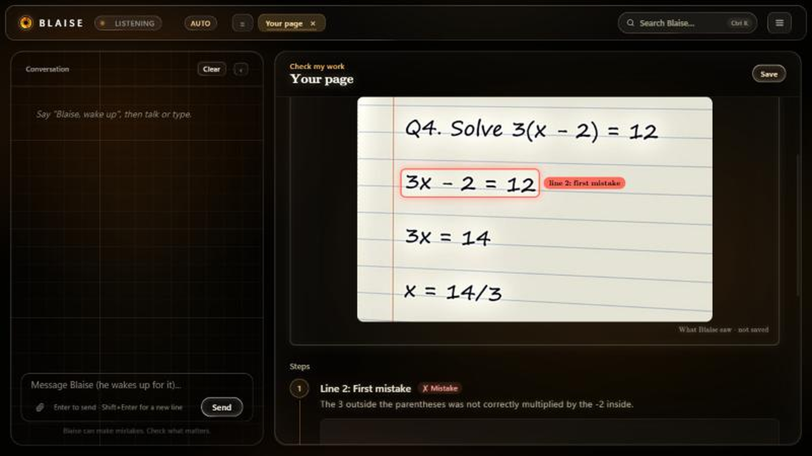
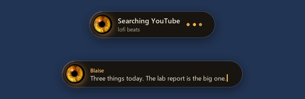
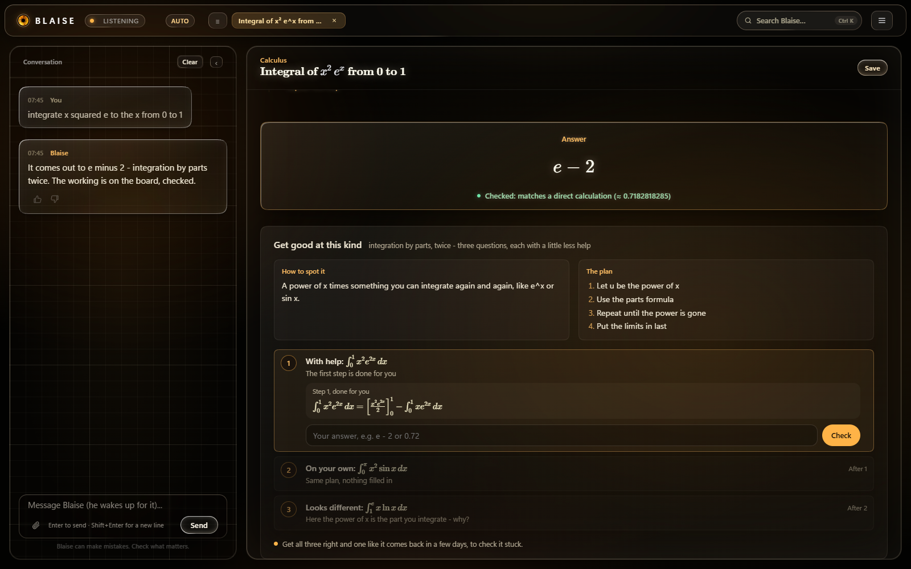
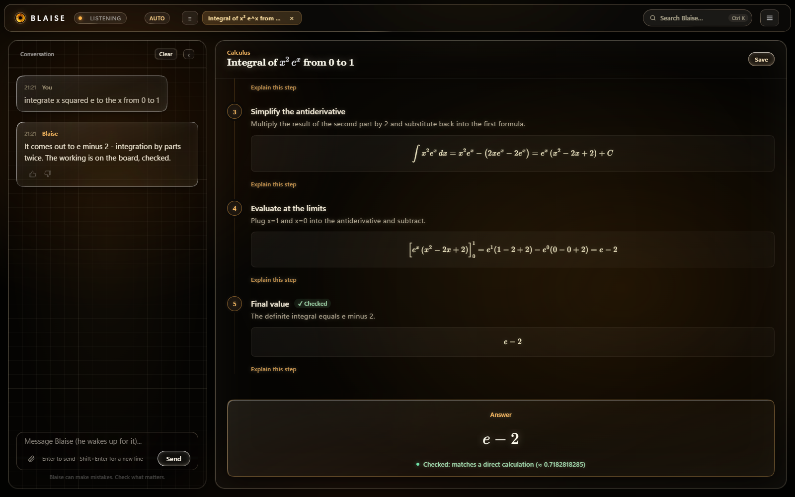
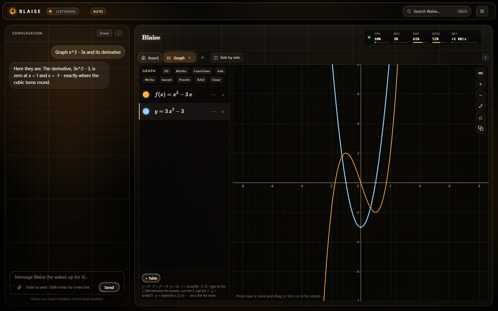

# Blaise — the study assistant that checks its own work

**PUBLIC RELEASE v6.4.3 · Windows**

Blaise is a voice assistant for students that lives on your PC. Say *"Blaise"* and talk, or type.

## New in 6.4.3

- **One clear first step.** Getting your free Gemini key now starts with one big "Get my free key" button. It opens Google AI Studio; there are just three short steps.
- **Blaise shows he's waiting.** While you copy your key in Google, a line in Blaise says he's waiting for it. When you come back he picks the key up by himself and checks it with Google. If you came back without copying it, he tells you which button to press.
- **Pasting is one click away.** "Paste a key myself" opens the box, and a pasted key is checked straight away - no button to press.
- **Help for the common snags.** "Having trouble?" covers the Google page not opening, nothing happening after copying, the free service not being available in your country, the free daily limits, and where your key is kept.
- **Fix:** a copied key that didn't work no longer stops Blaise watching - copy a new one and he tries again.

## New in 6.4.2

- **No more popping up out of nowhere.** Blaise used to open by himself, for example with the morning briefing at 7:30 or late at night. Now what he wants to tell you on his own is a quiet notification, and he says it the next time you talk to him. If you liked the old way, turn on "Let Blaise open and talk on his own" in Settings.
- **Quiet hours.** From 10 pm to 8 am he says nothing on his own at all. Alarms, timers and phone calls still ring. You can switch quiet hours off in Settings.
- **More like a real conversation.** When people are talking around him, Blaise answers only when you're talking to him, and stays quiet when you're talking to someone else. "Answer only when I'm talking to Blaise" in Settings turns this off.

## New in 6.4.1

- **The Physics Lab shows what it teaches.** In Collision, the rolling ball used to stop before it reached the other one, because floor friction acted like sliding friction. Now it rolls, and the hit swaps the speeds. The free-fall balls start with their bottoms level, so without air they really do land together. Each Predict first answer comes when the thing happens, with the landing times and speeds from the board.
- **Know how high you drop it.** There's a height ruler up the side, and balls snap to 0.5 m (hold Shift to place one freely). While you place a ball, a guide line shows its height. "Drop from __ m" drops at an exact height, and every ball shows where it was dropped from and its time to land.
- **Smoother and clearer.** Motion moves in even steps, balls are shaded with shadows, fading trails and velocity arrows, and the room fills the whole canvas. "Explain this" and "Ask Blaise" tell Blaise everything on the bench.
- **Explanations that match.** An explanation appears on screen straight away, and Blaise reads that same text out loud instead of making up his own. The quick cloud models go first, so you no longer wait for a slow model on your computer.
- **Tabs.** The × sits at the tab's edge, switching tabs no longer flickers, and the lit tab's glow isn't cut off.

## New in 6.4.0

- **A physics studio.** Every physics simulation fills its tab, with a tool rail. Record runs into a notebook and Blaise fits the graph: line, power, quadratic or exponential, or plot against √x, x² or 1/x. A pendulum gives you g with its uncertainty. There's a stopwatch on simulation time, a live motion graph, the ghost of your last run, and real-lab mode (three tries with measurement error and error bars). Challenge mode gives you a target to hit with the sliders. Prediction comes first: say what you think, then run it.
- **An anatomy practical.** Name the glowing part (small typos are fine), click the part asked for, or say where it is: above or below, left or right. You see it from a different side each time. Show only one part or hide it. Guided tours follow a bite of food, a breath of air, blood's round trip and nerve signals, one stop at a time, then test you on those parts.
- **Chemistry you do.** "Balance it yourself": you set the numbers and the atom counts follow, with a hint when you're stuck. "Limiting reagent": predict what runs out, then mix. In Equilibrium, every change holds still until you predict which way the position shifts from Q and K, with a Q-vs-K gauge. The periodic table has warmer colours and a molecule search.
- **DNA labs.** Mutate a gene and predict silent, missense, nonsense or frameshift before seeing the two proteins. Gel electrophoresis: a crime scene or a paternity case, where you predict the match and then run the gel. PCR: choose the primers (there are traps), predict the copies, and watch them double and level off.
- **Mistakes come back.** What you get wrong in the labs goes into your learner record and returns in the Daily 10.
- **Easier everywhere.** Settings open on what you change most and save as you go, with Undo. The tab strip fits any number of tabs. Flash cards show how many are due, lessons sit on the board, and course units show a progress bar. Work it out names the rule a wrong line broke. Graphs offer starters. Ctrl+K has "New note". Text help coaches you before rewriting and keeps a draft history.
- **Warm colours throughout.** Cold white text is now the warm cream of Blaise's theme.
- **Fixes.** Picture reading falls back to another model when Gemini is busy. Updates download quietly and say "Restart to update". Restart works from folders with spaces in their names.

## New in 6.3.2

- **Blaise looks at the pictures you send.** A picture sent in chat or dropped on the window arrived fine, but Blaise tried to search it for words, found none and couldn't say what was in it. Now he looks at it: a photo or screenshot of a maths question is read, then solved.
- **Found wherever it went.** Pictures you send are found in your study library as well as in Pictures, Desktop, Downloads and Documents, and BMP, TIFF, AVIF and JFIF pictures open too. (iPhone HEIC photos that this PC can't open get a message to send them as JPEG.)
- **Busy is not the end.** When Google's picture model is busy, Blaise tries another one before asking you to try again in a minute.

## New in 6.3.1

- **Any picture works.** Phone photos over 3 MB used to be refused, and so were GIF, BMP, TIFF and AVIF files. Now Blaise turns them the right way up and makes them a smaller JPEG, whether you attach them in chat, add them to your study library or put them in a study kit's picture cards. The graph's "picture of an equation" button takes any picture too. iPhone HEIC photos that this PC can't open get a clear message: send it as a JPEG.
- **Practice problems are made again.** Asking for practice problems always ran out of time before the maths model finished. Blaise now waits for it and makes three by default, each answer still checked by calculation.
- **Side by side lines up.** The labels over each half sit just under the tabs - never on top of them - with even 4px gaps above and below, and a tab's card starts 4px under the tabs.
- **A cleaner card editor.** Pointing at "Add or delete cards" no longer lights up a box around the whole section.

## New in 6.3.0

- **Your course as a map.** Pick AP Calculus AB, AP Biology, GCSE Maths (AQA) or A-level Chemistry (AQA) and the Courses tab shows every unit, with each idea coloured by your own answers: not started, learning, slipping, familiar or mastered (right on your own on three different days). It says what to study next - or "Fix this first" when something is slipping - and Teach me or Quick check hands it straight to Blaise. Say "I'm taking AP Calculus" or "show my course map".
- **Blaise finds the gap.** Get a problem wrong and Blaise checks the idea underneath it: a slip on the chain rule is often a gap in derivatives, and another chain-rule explanation won't fix that. A new lesson starts with a two-minute refresher when the idea underneath is shaky.
- **The Daily 10.** Ten quick questions a day, picked for you and mixed together: flash cards due today, questions from your study kits, mistakes from a day or more ago, yesterday's lesson from memory, the idea underneath what you're stuck on, and one problem to do on your own. Answer first, then see it, then say honestly whether you had it - only answers on your own count. Cards go back into your deck's schedule, and a streak counts the days you finish. Say "start my Daily 10", or yes when the morning briefing offers it.
- **More ideas Blaise knows.** 25 new ideas in Blaise's map of how things connect - implicit differentiation, related rates, L'Hopital's rule, osmosis, meiosis, standard form, bonding and more - each linked to what it builds on.

## New in 6.2.0

- **Lessons like a course.** Say "teach me derivatives" and the lesson runs on the board: what you'll be able to do by the end, the words you'll meet, each part shown, worked through and then tried by you, a recap - and a quick quiz booked in your study tasks a few days later, when it's half forgotten.
- **Study kits.** Turn a file, a web page or just a topic into a whole kit in about a minute: notes, flash cards you check before they join your deck, a quiz that explains every wrong answer, a written test marked out of 10 with what earns full marks, fill in the blank, a two-voice podcast, Match, a brain dump, a map from memory and picture cards from your own diagrams.
- **Each subject learned its own way.** Sciences fix the common misconceptions, maths and physics make you choose the method before you solve, history, English and economics get exam questions by command word and an essay coach that never writes it for you, and languages get the most useful words first and spoken sessions where you fix your own mistakes.
- **A tutor that holds the line.** After a worked answer, Blaise gives you one like it to do on your own, and only that counts. The help fades as you get better and steps back when you slip. Choose how he teaches: step by step, show me, keep it simple, ask me questions, exam ready or a real-world story.
- **Memory that lasts.** An idea counts as mastered only when you've got it right on three different days. Podcasts, audio summaries and lectures end with three questions from memory, and flash cards you keep missing or mixing up get rewritten or a "what's the difference?" card.
- **Proof it works.** My progress now leads with the number that predicts the exam - how much you get right on your own, days after you last studied it - and how often "sure" really meant right. And Blaise no longer answers a "hmm" or an "uh".

## New in 6.1.1

- **Much lighter.** Sitting open and idle, Blaise used to keep two or three processor cores busy. Now it's about a fifth of one. Small animations no longer redraw the whole window 144 times a second, the system strip reads your PC without starting PowerShell every few seconds, and Settings opens in under a second.
- **Long chats stay quick.** Replies used to leave thousands of animated letters behind, so the chat got slower the longer you used it. Hearing you talk and the capsule at the top of the screen now cost a fraction of what they did.
- **A resting eye.** The eye on the home screen stays still while Blaise is idle, and only turns while he's thinking or speaking.
- **New loading beads.** Three still, sand-coloured beads show everywhere Blaise is working on something.
- **The math board fits.** Long equations break at "=" the way you'd write them by hand, and nothing runs off the edge any more. Fractions in the step text are full size.
- **Definite integrals are checked.** Blaise works out the value itself, makes sure the answer matches where the working ends, and never shows an answer that its own steps contradict.

## New in 6.1.0

- **Boss battle.** Your next exam becomes a boss. Its health bar is your weakest topics, and its questions are your own mistakes and the flash cards you keep forgetting. Say or type each answer: a right one knocks a chunk off, a wrong one costs one of three hearts and shows where it went wrong. Beat it and those topics count as stronger. Say "start a boss battle", or find it in Tools > Study.
- **Study duel.** Race a friend on the same questions. Pick a deck and read them the 4-letter code, or type theirs. The same question shows on both screens at once, and whoever answers right first gets the point. First to 5 wins, and what you both missed goes into a "missed in duels" deck for each of you.
- **Fixes for the Mac.** The words in the island are a proper size again, and a few Windows-only parts (the hand tracker's window, storage clean-up) no longer trip up the Mac version.

## New in 6.0.3

- **The pointer light matches the button you see**, instead of drawing a box of a different size.
- **Settings groups are cards:** a closed group shows a two-letter tile like the Tools ones, what's inside and how many sections.
- **Two-step sign-in can be set up again:** its QR code shows properly.
- **Dots and loaders with some depth:** warm beads that rise and glow, spinners with a glowing tail, and live and
  camera lights set in a ring.

## New in 6.0.2

- **Hard maths answers sooner:** reading a problem on your screen takes a second or two instead of about 17, and for a
  hard one Blaise says straight away that he's working it out on the board, then tells you the checked answer.
- **More reliable hard answers:** the free reasoning models get room to finish, a used-up daily allowance is remembered
  after a restart, and an answer that can't be checked has to match the value Blaise worked out by calculation.
- **A clean answer box:** the final answer only, never the brain thinking out loud.
- **Learning mode that teaches:** "have a go first" holds more reliably, and a new Tutor level gives hints and questions
  first and a quick check after every answer.
- **Fixes:** no grey window after clicking the eye while minimized; the voice test isn't answered as if you were
  talking to Blaise.

## New in 6.0.1

- **Logic puzzles are checked by brute force too:** knights and knaves, line-ups that fit the rules, the fewest river
  crossings. Blaise writes a small program that tries every possibility.
- **A second check when it matters:** if the checking program and Blaise's reasoning disagree, a model from a
  different AI company writes a second program, so one buggy program can't mislead him.

## New in 6.0: a much smarter brain

- **Two minds on every hard question.** Each one is worked out separately, at the same time, by models from different
  AI companies when you've added more keys (Gemini, Groq, NVIDIA, OpenRouter, Claude, OpenAI...). When they disagree, a
  referee finds the step that went wrong.
- **A program checks the maths.** For a counting, probability or number puzzle, Blaise writes a tiny program that works
  the answer out by brute force and runs it safely on your PC. What AI models usually get wrong - letters in a word,
  which decimal is bigger, weekdays, huge powers - is worked out by code instead.
- **University and postgraduate maths, computed exactly:** topology (homology, fundamental groups), group theory, Galois
  groups, residues, ODEs, number theory, Groebner bases, Jordan forms, recurrences, Markov chains, Laplace and Fourier.
- **Connecting ideas.** *"What if I take the area under this curve?"*, *"is a t-distribution a kind of normal
  distribution?"*, *"if I double the speed, what happens to the energy?"* - Blaise links it to what you were just
  talking about and puts the chain on the board with a picture. He knows 267 ideas, from school maths to quantum
  mechanics, the common mix-ups, and what tells close ideas apart.
- **Worksheet boards**, more exact calculators (statistics, chemistry, physics, biology, money), and sound from your own
  computer is no longer answered as if you'd said it.

## From 5.0: he sees your work, and you get good at it

- **Check my work with the camera.** Hold your page up and say *"check my work"*. Blaise reads exactly what's written,
  says which part he couldn't read instead of guessing, and shows the photo with the first mistake boxed, and why. The
  camera is off until you turn it on, and a light shows while it's on.
- **Get good at this kind.** Under every worked answer: how to spot this kind of question, the plan as steps that work
  on any of them, and three new questions with less help each time, from the first step done for you to one that looks
  different. Every answer is checked by calculation, and one comes back a few days later to check it stuck.
- **Blaise at the top of the screen.** One small capsule with his eye in it shows what he's doing, what he's saying and
  the box you type in. Slide it along the top edge, or bring back the floating eye in Settings.
- **Hand gestures.** Say *"gesture mode"*: point, pinch to click, drag, scroll, swipe, and move windows with your hand
  in front of the webcam. Your hand is tracked on your PC; nothing about it is sent anywhere.
- **Steadier.** Blaise closes much less often, the eye is easier to drag, and making PDFs works with the newest Edge.

## See it

| Get good at this kind | A worked answer, step by step and checked |
|---|---|
|  |  |

**A graphing calculator built in.** Ask for a graph by voice or type it, in 2D or 3D, with limits, integrals and visual
proofs:

*Screenshots show Blaise's real window with demo content.*

## From 4.1: a calmer look

- A home screen on one centre line, a chat that reads like a log, a calmer blackboard, virus scans with Windows Defender,
  storage clean-up that only removes what you say yes to, and searchable Settings.

## From 4.0: your whole course, run for you

- **Course Autopilot.** Connect Canvas, Google Classroom or Teams and say *"plan my courses"*. Every exam and big
  assignment becomes a goal with steps timed to its date.
- **Every answer checked.** Maths, units and chemistry are worked out exactly. Before Blaise says your answer is right
  or wrong, he checks it.
- **Blaise in your pocket.** On a call from your phone, tap *Snap a problem* and photograph a worksheet. It goes straight
  to your PC, encrypted like your voice.
- **A tutor over your shoulder.** *"Sit with me while I do my homework"*: he speaks up for a clear mistake and offers a
  small nudge when you're stuck, never the answer.
- **My progress.** What you really remember, goals reached on time and what you got done this week, all from your own
  records.

## Also in Blaise

- **Maths, solved and checked.** Full working on the board, from algebra to differential equations, and every answer
  is checked by calculation before you see it.
- **It sees what you're working on.** *"Look at this"* reads the window you're in. *"Check my work"* finds your first
  mistake and gives a hint, not the answer.
- **Study like the research says.** Flash cards with spaced reviews (bring your Anki decks and Quizlet sets), practice
  that brings your mistakes back, an exam predictor, and Physics, Chemistry and Bio labs.
- **Your room and your day.** Calendar, tasks, alarms, a morning briefing, Spotify and smart lights.

## Download

1. Open **[Releases](../../releases/latest)** and download **Blaise-5.0.0-Setup.exe** (about 160 MB).
2. Run it. Because Blaise isn't code-signed yet, Windows may show **"Windows protected your PC"**. Click
   **More info → Run anyway**. Updates after that are different: every update is checked against Blaise's own
   signature before it installs.
3. Create your Blaise account, then get your **free Gemini key** in about 30 seconds: press *Get my free key*, press
   *Create API key* in Google AI Studio, and copy it. Blaise fills it in by himself.

Installed copies update themselves.

## What you need

- Windows 11 64-bit (Windows 10 should work; tell us if it doesn't)
- A microphone, and an internet connection
- A Google account (for the free Gemini key)
- Optional: a phone, to call Blaise and snap problems

## Privacy, in short

- Your voice goes to Google Gemini while Blaise is awake, with **your own key**. Before that, Blaise only listens for
  its name, on your PC.
- Your notes, grades, files and voiceprint stay on your PC (the voiceprint is encrypted and never leaves it).
- Blaise only looks at your screen when you ask. Calls and photos from your phone are encrypted end to end. Full
  details: the privacy policy inside the app (Settings → About).

## Feedback

Blaise can make mistakes. Please tell us what breaks and what you'd love: thumbs up/down in the chat, *Send crash
reports* in Settings, open an **[issue](../../issues)**, or email **rytomaaaaa@projectblaise.com** (also for privacy
requests and security problems; please report those privately).

*Older beta versions (1.x): [Blaise-Downloads](https://github.com/rytomaaaaa/Blaise-Downloads).*
