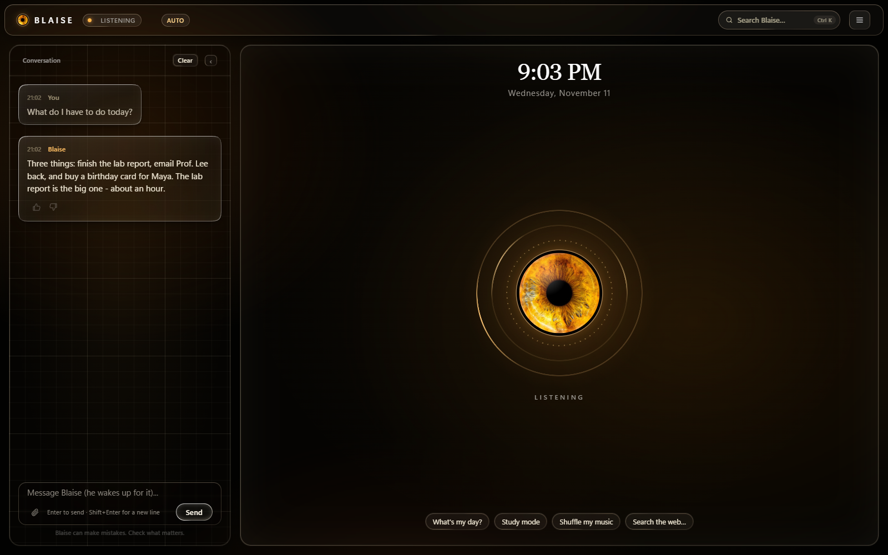

# Blaise — the study assistant that checks its own work

**PUBLIC RELEASE v4.1.0 · Windows**

Blaise is a voice assistant for students that lives on your PC. Say *"Blaise"* and talk, or type.

## New in 4.1: a calmer look, virus scans and storage clean-up

- **A calmer look.** The home screen sits on one centre line: the clock, the eye, and three small cards for what's
  next, your nearest exam or goal, and today's flash cards. The rings round the eye fill up as you get through today's
  plan and your cards. The glow and extra shadows are gone.
- **A chat that reads like a log.** Glass bubbles, all on the left, and Blaise's words write themselves out as he
  speaks.
- **A calmer blackboard.** Your question on one line, the steps numbered down a single line, and the answer in one card.
- **Virus scans.** *"Scan my computer for viruses"*, *"scan my Downloads"* or *"am I protected?"*: Blaise runs Windows
  Defender for you and tells you what it found. He never changes a security setting.
- **Storage clean-up.** *"What's taking up space?"* shows your biggest folders and files, old installers, temporary
  files and the Recycle Bin. Blaise frees space only after you say yes, and files you might want back go to the
  Recycle Bin.
- **Easier Settings.** Search them (Ctrl+F), and the sections open and close.
- **Blaise knows what he can do.** Ask *"can you...?"* and he answers from his real abilities.

## See it

| A worked answer, step by step and checked | Course Autopilot: every exam and essay planned |
|---|---|
|  |  |

**A graphing calculator built in.** Ask for a graph by voice or type it, in 2D or 3D, with limits, integrals and visual
proofs:

*Screenshots show Blaise's real window with demo content.*

## From 4.0: your whole course, run for you

- **Course Autopilot.** Connect Canvas, Google Classroom or Teams and say *"plan my courses"*. Every exam and big
  assignment becomes a goal with steps timed to its date.
- **Every answer checked.** Maths, units and chemistry are worked out exactly. Before Blaise says your answer is right
  or wrong, he checks it.
- **Blaise in your pocket.** On a call from your phone, tap *Snap a problem* and photograph a worksheet. It goes straight
  to your PC, encrypted like your voice.
- **A tutor over your shoulder.** *"Sit with me while I do my homework"*: he speaks up for a clear mistake and offers a
  small nudge when you're stuck, never the answer.
- **My progress.** What you really remember, goals reached on time and what you got done this week, all from your own
  records.

## Also in Blaise

- **Maths, solved and checked.** Full working on the board, from algebra to differential equations, and every answer
  is checked by calculation before you see it.
- **It sees what you're working on.** *"Look at this"* reads the window you're in. *"Check my work"* finds your first
  mistake and gives a hint, not the answer.
- **Study like the research says.** Flash cards with spaced reviews (bring your Anki decks and Quizlet sets), practice
  that brings your mistakes back, an exam predictor, and Physics, Chemistry and Bio labs.
- **Your room and your day.** Calendar, tasks, alarms, a morning briefing, Spotify and smart lights.

## Download

1. Open **[Releases](../../releases/latest)** and download **Blaise-4.1.0-Setup.exe** (about 160 MB).
2. Run it. Because Blaise isn't code-signed yet, Windows may show **"Windows protected your PC"**. Click
   **More info → Run anyway**. Updates after that are different: every update is checked against Blaise's own
   signature before it installs.
3. Create your Blaise account, then get your **free Gemini key** in about 30 seconds: press *Get my free key*, press
   *Create API key* in Google AI Studio, and copy it. Blaise fills it in by himself.

Installed copies update themselves.

## What you need

- Windows 11 64-bit (Windows 10 should work; tell us if it doesn't)
- A microphone, and an internet connection
- A Google account (for the free Gemini key)
- Optional: a phone, to call Blaise and snap problems

## Privacy, in short

- Your voice goes to Google Gemini while Blaise is awake, with **your own key**. Before that, Blaise only listens for
  its name, on your PC.
- Your notes, grades, files and voiceprint stay on your PC (the voiceprint is encrypted and never leaves it).
- Blaise only looks at your screen when you ask. Calls and photos from your phone are encrypted end to end. Full
  details: the privacy policy inside the app (Settings → About).

## Feedback

Blaise can make mistakes. Please tell us what breaks and what you'd love: thumbs up/down in the chat, *Send crash
reports* in Settings, open an **[issue](../../issues)**, or email **rytomaaaaa@projectblaise.com** (also for privacy
requests and security problems; please report those privately).

*Older beta versions (1.x): [Blaise-Downloads](https://github.com/rytomaaaaa/Blaise-Downloads).*
