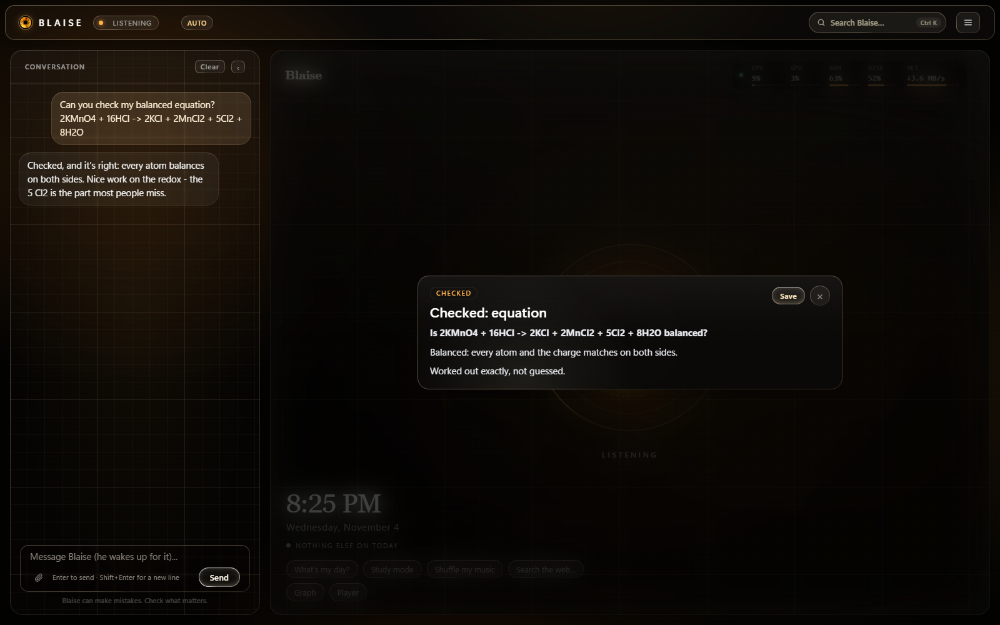
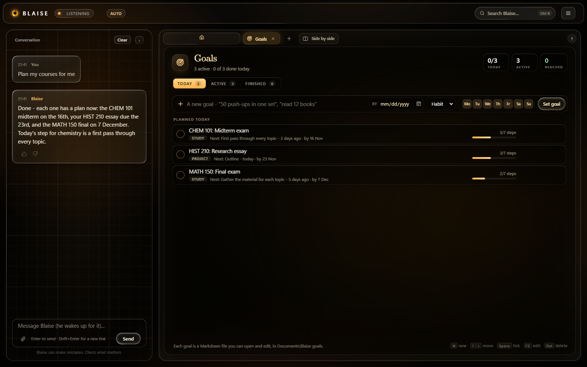
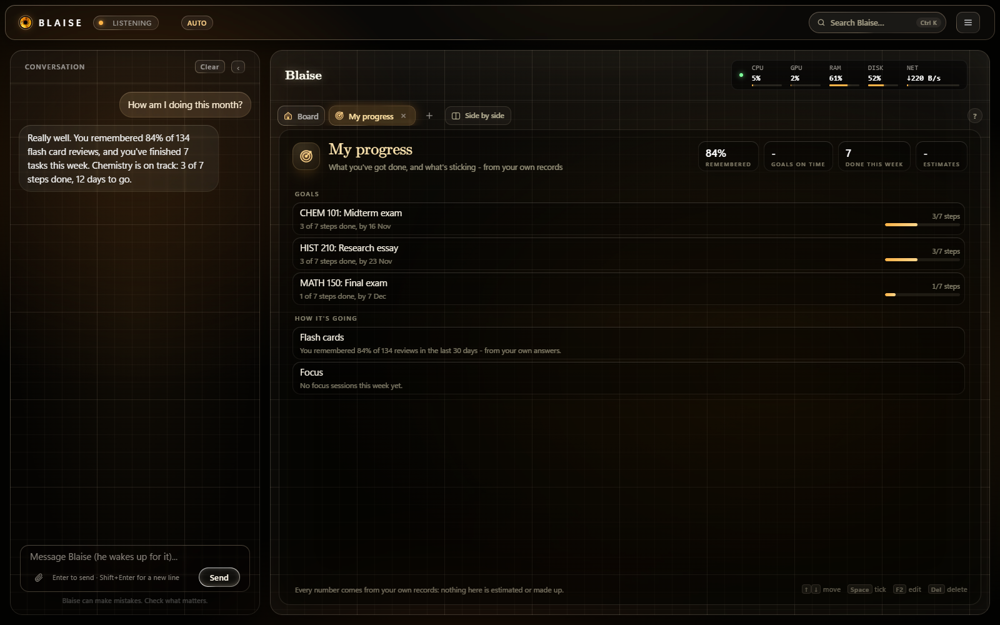

# Blaise — the study assistant that checks its own work

**PUBLIC RELEASE v4.0.1 · Windows**

Blaise is a voice assistant for students that lives on your PC. Say *"Blaise"* and talk, or type.

## New in 4.0: your whole course, run for you

- **Course Autopilot.** Connect Canvas, Google Classroom or Teams and say *"plan my courses"*. Every exam and big
  assignment becomes a goal with steps timed to its date: flash cards, practice and a mock exam for exams; read the
  brief, research, outline, draft, revise and hand in for essays and projects.
- **Every answer checked.** Chemistry is now worked out exactly: balancing equations (redox and ions too), molar masses,
  grams to moles. It sits next to the checked maths and units. Before Blaise says your answer is right or wrong, he
  checks it.
- **Blaise in your pocket.** On a call from your phone, tap *Snap a problem* and photograph a worksheet. It goes straight
  to your PC, encrypted like your voice, and Blaise helps you with it there and then.
- **A tutor over your shoulder.** *"Sit with me while I do my homework"*: he speaks up for a clear mistake, and if you
  seem stuck for a few minutes he offers a small nudge, never the answer.
- **My progress.** What you really remember, your honest score, goals reached on time and what you got done this week,
  all from your own records. Nothing is estimated or made up.
- **A sharper brain and 30 voices.** Better at corrections, dates and deadlines, and plans that clash. You can pick
  Gemini's voices and a calm Butler AI tone, and choose what Blaise calls you.

## Fixed in 4.0.1

- **Typing to Blaise while he's asleep works again:** your message wakes him and he answers it. Before, it woke him
  but the message itself was lost.
- **What's new is easier to read:** only the list scrolls, it shows the version names you know (4.0.1, not 7.0.1), and
  fixes you can see come with a picture of what changed.

## See it

| Course Autopilot: every exam and essay planned | My progress, from your own records |
|---|---|
|  |  |

**A graphing calculator built in.** Ask for a graph by voice or type it, in 2D or 3D, with limits, integrals and visual
proofs:

*Screenshots show Blaise's real window with demo content.*

## Also in Blaise

- **Maths, solved and checked.** Full working on the board, from algebra to differential equations, and every answer
  is checked by calculation before you see it.
- **It sees what you're working on.** *"Look at this"* reads the window you're in. *"Check my work"* finds your first
  mistake and gives a hint, not the answer.
- **Study like the research says.** Flash cards with spaced reviews (bring your Anki decks and Quizlet sets), practice
  that brings your mistakes back, an exam predictor, and Physics, Chemistry and Bio labs.
- **Your room and your day.** Calendar, tasks, alarms, a morning briefing, Spotify and smart lights.

## Download

1. Open **[Releases](../../releases/latest)** and download **Blaise-4.0.1-Setup.exe** (about 160 MB).
2. Run it. Because Blaise isn't code-signed yet, Windows may show **"Windows protected your PC"**. Click
   **More info → Run anyway**. Updates after that are different: every update is checked against Blaise's own
   signature before it installs.
3. Create your Blaise account, then get your **free Gemini key** in about 30 seconds: press *Get my free key*, press
   *Create API key* in Google AI Studio, and copy it. Blaise fills it in by himself.

Installed copies update themselves.

## What you need

- Windows 11 64-bit (Windows 10 should work; tell us if it doesn't)
- A microphone, and an internet connection
- A Google account (for the free Gemini key)
- Optional: a phone, to call Blaise and snap problems

## Privacy, in short

- Your voice goes to Google Gemini while Blaise is awake, with **your own key**. Before that, Blaise only listens for
  its name, on your PC.
- Your notes, grades, files and voiceprint stay on your PC (the voiceprint is encrypted and never leaves it).
- Blaise only looks at your screen when you ask. Calls and photos from your phone are encrypted end to end. Full
  details: the privacy policy inside the app (Settings → About).

## Feedback

Blaise can make mistakes. Please tell us what breaks and what you'd love: thumbs up/down in the chat, *Send crash
reports* in Settings, open an **[issue](../../issues)**, or email **rytomaaaaa@projectblaise.com** (also for privacy
requests and security problems; please report those privately).

*Older beta versions (1.x): [Blaise-Downloads](https://github.com/rytomaaaaa/Blaise-Downloads).*
