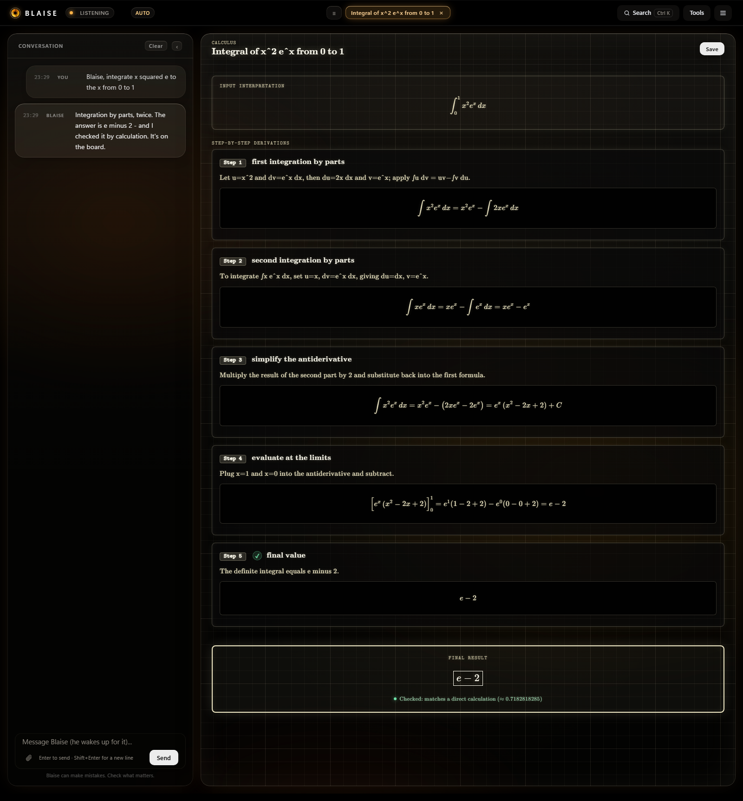
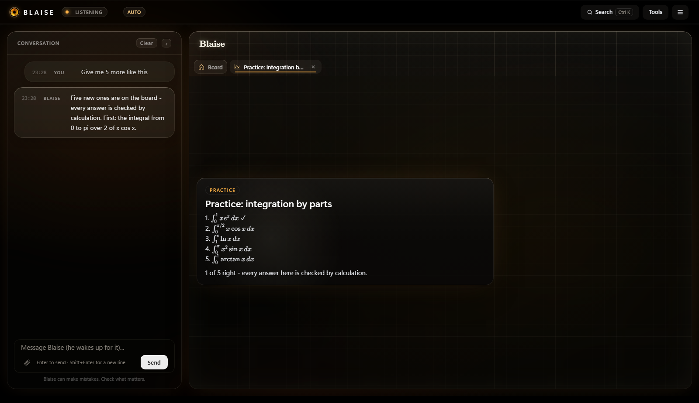
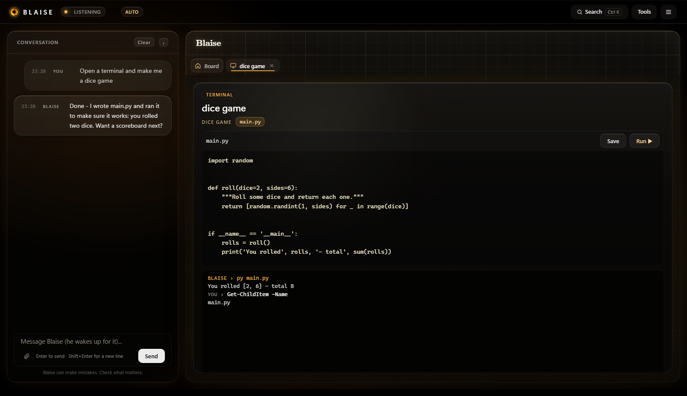
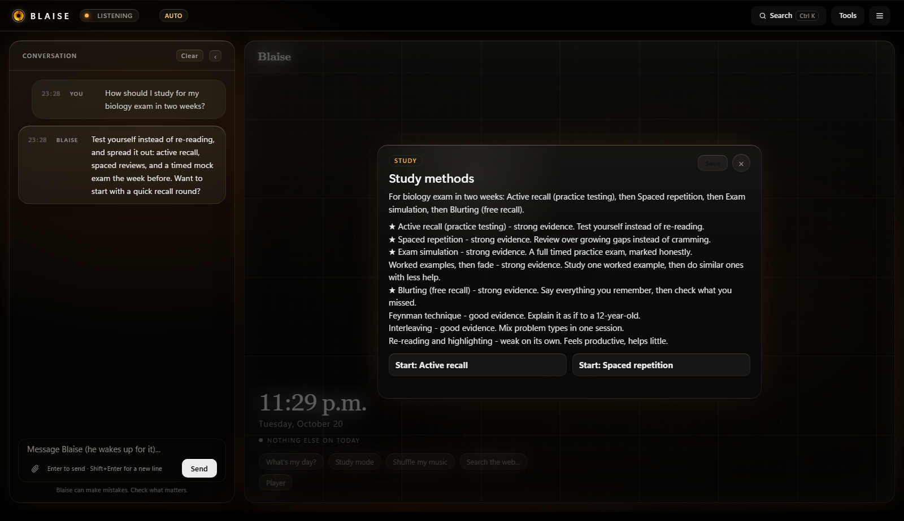

# Blaise — the study assistant that checks its own work

**PUBLIC RELEASE v1.0.0 · free · Windows**

Blaise is a voice assistant for students that lives on your PC. Say *"Blaise"* and talk:

- **Maths, solved and checked.** Full working on the board, from algebra to differential equations — and every answer is
  checked by calculation before you see it. *"Give me 5 more like this"* makes practice problems with proved answers.
- **It sees what you're working on.** *"Look at this"* reads the window you're in; a glowing box points at the spot.
  *"Check my work"* finds your first mistake and gives a hint, not the answer.
- **Study like the research says.** Active recall, spaced reviews, an exam predictor from your past papers, flash cards
  from your slides, lecture notes, a focus guard that nudges you off YouTube.
- **Your whole term.** *"Plan my semester from my syllabus"* sets every exam and deadline.
- **Code together.** A terminal where Blaise writes code and runs it to prove it works.
- **Your room and your day.** Smart lights (*"chill mode"*, *"focus mode"*), Spotify, calendar, tasks, a morning briefing.

## See it

| Practice problems with proved answers | Code together in the Terminal |
|---|---|
|  |  |

**Study like the research says** — ask how to study and Blaise ranks the methods by evidence, then coaches you through one:

*Screenshots show Blaise's real window with demo content.*

## Download

1. Open **[Releases](../../releases/latest)** and download **Blaise-1.0.0-Setup.exe** (about 110 MB).
2. Run it. Because Blaise isn't code-signed yet, Windows may show **"Windows protected your PC"** —
   click **More info → Run anyway**. (Updates after that are different: every update is checked against Blaise's own
   signature before it installs.)
3. Create your Blaise account, then get your **free Gemini key** in about 30 seconds: press *Get my free key*, press
   *Create API key* in Google AI Studio, copy it — Blaise fills it in by himself.

Installed copies update themselves.

## What you need

- Windows 11 64-bit (Windows 10 should work; tell us if it doesn't)
- A microphone, and an internet connection
- A Google account (for the free Gemini key)
- Optional: a graphics card for running maths on your own PC (Ollama)

## Privacy, in short

- Your voice goes to Google Gemini while Blaise is awake, with **your own key**. Blaise only listens for its name on your
  PC before that.
- Your notes, grades, files and voiceprint stay on your PC (the voiceprint is encrypted and never leaves it).
- Blaise only looks at your screen when you ask. Full details: the privacy policy inside the app (Settings → About).

## Feedback

Blaise can make mistakes. Please tell us what breaks and what you'd love: thumbs up/down in the chat, *Send crash
reports* in Settings, open an **[issue](../../issues)**, or email **rytomaaaaa@projectblaise.com** (also for privacy
requests and security problems — please report those privately).

*Older beta versions (1.x): [Blaise-Downloads](https://github.com/rytomaaaaa/Blaise-Downloads).*
